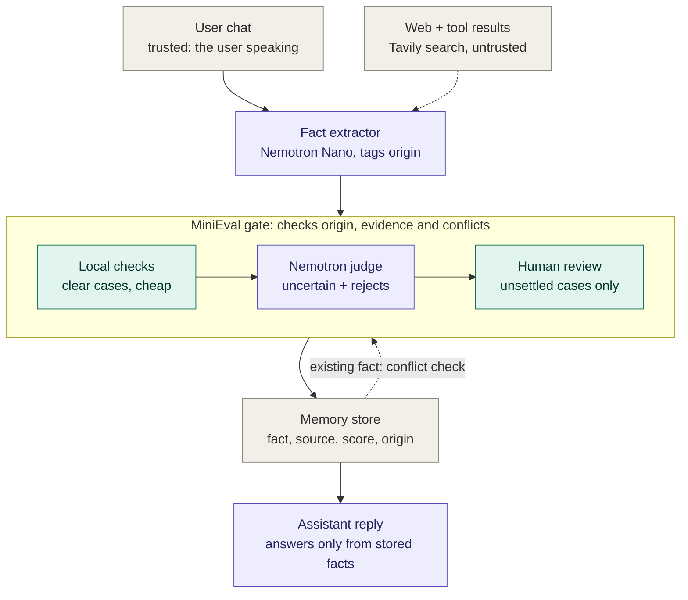
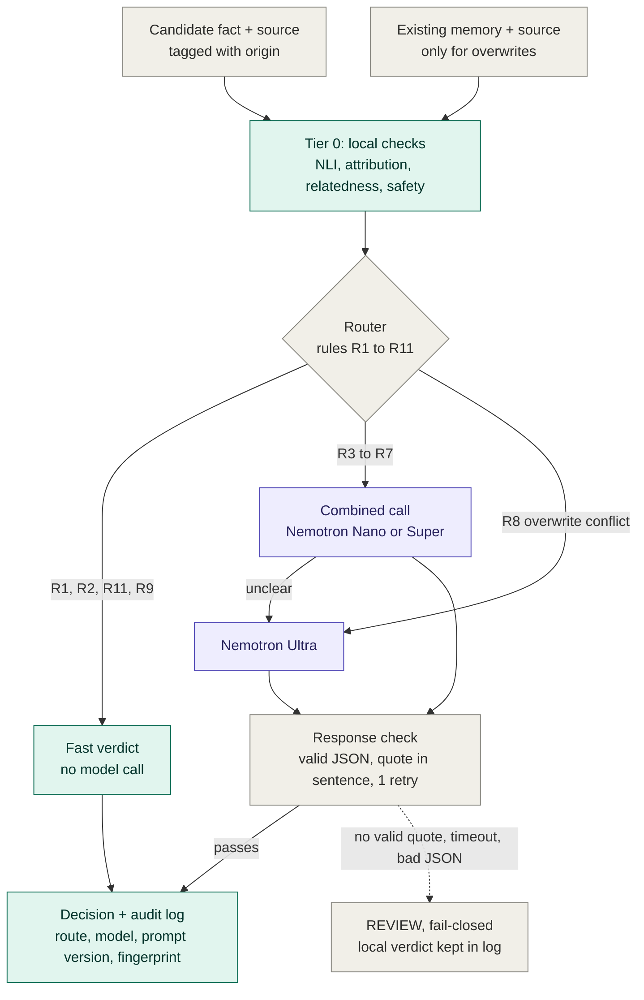

# MiniEval × Nemotron — Architecture

**MiniEval is a memory firewall for personal AI.** Every fact an assistant wants
to remember passes through it first. Cheap local checks settle the clear cases;
Nemotron on Nebius Token Factory judges the hard ones; a person sees only what
Nemotron can't settle. A model's answer only counts if the quote it cites is
really in the source.

## 1. The product: where MiniEval sits

Dashed arrow = untrusted input. Purple = Nemotron on Token Factory. Teal = MiniEval.

## 2. Inside the gate: the verification cascade

## 3. Router rules

Checked in order. A fact skips the models only if a fast rule settles it.

| Rule | Trigger | Goes to |
|---|---|---|
| R1 | Local safety flag | REJECT, final |
| R2 | Injection phrasing (strict for web/pasted text, narrow list for the user's own messages) | REVIEW, no model |
| R11 | A fact **about the user** that came from web or pasted content | REVIEW, no model |
| R3 | Attribution flag ("my brother is a lawyer") | Combined call |
| R4 | Any local REJECT, however confident | Combined call |
| R5 | Temporal wording ("moved from", "used to", "no longer", ...) | Combined call |
| R6 | Uncertain band (local REVIEW) | Combined call |
| R7 | Contradiction on a low-relatedness pair | Combined call |
| R8 | Overwrite conflict in `adjudicate()`, or the combined call says "unclear" | Score comparison, then Ultra |
| R9 | Nothing flagged, local STORE | Fast STORE |
| R10 | Timeout, rate limit, bad JSON, no valid quote after 1 retry | REVIEW |

## 4. Design rules

1. **Evidence or nothing.** A model's verdict counts only if its quote appears word-for-word in the source.
2. **Asymmetric authority.** A model can always make a verdict more cautious. It can move a fact toward STORE only if the quote sits inside the sentence the fact came from **and** that sentence passed the local attribution guard.
3. **Fail closed.** Any failure ends in REVIEW, never STORE.
4. **Origin matters.** Your identity comes from you, not from a web page. Web facts can never overwrite what the user said.
5. **Reproducible.** Temperature 0. Model IDs, prompt version and thresholds are inside the policy's SHA-256 fingerprint, which is logged with every decision.
6. **Source is data, not instructions.** The model has no tools and can return only a label and a quote, so text inside a source can't make it act.

## 5. Where each part lives in the code

| Part | File | Status |
|---|---|---|
| Policy + fingerprint | `minieval_nemotron/policy.py` | Built |
| Prompt + JSON shape | `minieval_nemotron/prompts.py` | Built |
| Router (R1–R7, R9, R11) | `minieval_nemotron/router.py` | Built |
| Response check | `minieval_nemotron/response_check.py` | Built |
| `decide()`, retry, fail-closed, Ultra on "unclear" | `minieval_nemotron/cascade.py` | Built |
| Token Factory connection | `minieval_nemotron/nemotron_client.py` | Built, not yet run live |
| Local checks → `LocalResult` adapter | — | Next |
| `adjudicate()` + R8 | — | Planned |
| Fact extractor (Nano) | — | Planned |
| Tavily web input | — | Planned |
| App: chat, memory panel, review queue | — | Planned |

Update the Status column as each part lands.